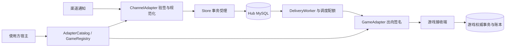

# 架构与公开边界

GameHub 负责渠道事件受理、可靠交付、配置版本和操作审计。游戏负责商品规则、玩家状态、权威账本和实际经济事务。两边通过 HTTP 契约连接，游戏采用什么引擎、脚本语言或数据库，不影响 Hub 的通用实现。

公开源码包含可运行的演示服务、独立宿主示例、迁移、测试、部署示例和接入文档。默认构建不扫描本地目录，也不包含具体项目的头文件、库或数据库定义。

## 模块与依赖

| 模块 | 职责 | CMake 目标 |
| --- | --- | --- |
| core | 配置、领域数据、抽象适配器、契约编码、调度和固定桶统计 | `GameHub::core` |
| adapters | 公共演示 HMAC 协议和合成规则 | `GameHub::adapters` |
| bootstrap | 显式工厂注册、专用配置检查和注册表组装 | `GameHub::bootstrap` |
| storage | Hub 自有表、事务、租约、尝试历史、归档和运行控制 | `GameHub::storage` |
| service | HTTP、认证、后台协程、交付和启停 | `GameHub::service` |

服务层接收已构造的 `Config` 和 `GameRegistry`，不依赖具体游戏工厂。默认入口只登记演示协议；[独立宿主示例](../examples/custom-host/README.md)演示使用方如何登记自己的类型，再复用同一个服务层。

## 受理与交付

事件身份为 `(gameId, taskType, namespace, bizKey)`；一个事件展开为一个或多个区服任务。区服目标在首次受理时固定，之后新增区服不会补收历史广播。

1. 渠道适配器同步检查原始请求、签名及业务字段，返回拥有独立数据的 `Submission`。
2. 事件、逐服任务和审计在同一个 Hub 事务提交。相同身份和相同摘要返回原事件；同身份不同内容返回冲突。
3. Worker 用短事务领取到期任务、递增代次、创建尝试记录并设置租约。提交后才发送 HTTP，不占用数据库行锁等待网络。
4. 收到匹配 `taskId` 且 `committed=true` 的 HTTP 200 后，按任务、代次、状态和有效租约确认；任务状态与尝试结果一起提交。
5. 网络错误、错误确认和异常按退避重试；租约过期可以恢复，达到尝试上限转为 failed。人工重排保留原业务身份及尝试历史，并记录审计。

只有明确的 MySQL 死锁会触发有限整事务重试。断连、取消和未知 COMMIT 结果不会自动重放 SQL，调用方继续使用原身份重试。

租约只能阻止旧 Worker 覆盖 Hub 状态，无法收回已经发送的请求。因此交付语义是至少一次。游戏接收端必须在权威持久化事务中把业务去重与实际经济修改一起提交，再确认成功；Hub 的 done 和人工重排都不能替代游戏账本。

## 并发与生命周期

HTTP、数据库协程和 Worker 在同一个事件循环访问应用状态。协程等待 I/O 时让出执行权；应用处理回调先取得强引用，跨请求保存的内容使用自有字符串。请求视图只在同步解析期间有效。

调度按游戏轮转，领取前预占全局及游戏名额，并排除本进程已满额的区服。RAII 在正常、异常和取消路径归还名额。繁忙槽位在任务数及时间预算内连续处理，空闲按 pollMs 退避。

游戏与区服额度是进程内额度。共享控制以版本比较更新，各实例刷新并报告已应用版本；下调额度不撤销已经准入的任务。多个实例需规划总额度和 Worker 游戏范围，当前没有分布式总配额。

停机停止新领取并关闭依赖，在途未确认任务依靠租约恢复。游戏端仍须处理“业务已提交、确认响应丢失”的情况。

## 持久数据

Hub 使用独立 MySQL 数据库，由配套的公开迁移文件管理结构，程序就绪检查会校验结构版本和核心表。

| 表或表组 | 用途 |
| --- | --- |
| hub_event | 事件身份、摘要、契约版本和载荷 |
| delivery_task / delivery_task_archive | 活动任务及已完成归档 |
| delivery_attempt | 各领取代次的持久尝试历史 |
| delivery_task_counts / game_delivery_task_counts | 随业务事务更新的分片计数 |
| config_head / config_version | 配置头及不可变版本内容 |
| config_server_state | 区服报告的已应用版本和摘要 |
| game_delivery_control | 带版本的共享投递控制 |
| audit_log / schema_version | 操作审计及结构版本 |

归档只处理到期的 done 任务。载荷清理在后续独立事务执行，原事件身份和摘要长期保留，迟到的重复订单不会重新生成任务。尝试历史不因重排或任务归档而消失。

## 配置分发

发布将版本、配置头、通知事件、逐服任务和审计一起提交。通知只携带版本号；游戏启动拉取最新版，收到通知后拉指定版本，拒绝旧版本覆盖，原子应用并持久保存当前版本，再上报应用状态。

拉取响应提供 `canonicalContent` 和摘要，接收端按其 UTF-8 原文验摘要，避免不同语言重新序列化浮点数产生差异。通知确认和实际应用是两个状态；应用回报不会自动改变通知任务。

## 使用方集成

通用源码可以单独构建，也可以作为使用方工程的子目录。嵌入时默认关闭演示可执行程序、公共测试及安装规则，使用方维护自己的入口和发行内容。

具体协议、商品规则、玩家数据库及凭据放在使用方工程。仓库根的 `private/` 只是被忽略的本地工作目录，公开源码不依赖它。公共测试只使用合成数据和自行创建的临时数据库。

接入步骤见[接入指南](integration.md)，请求与响应见[接口契约](api.md)，构建与迁移见[README](../README.md)。
